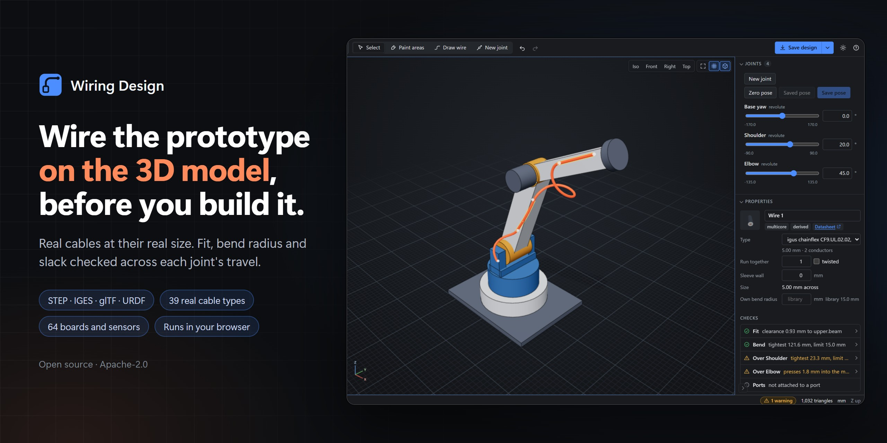
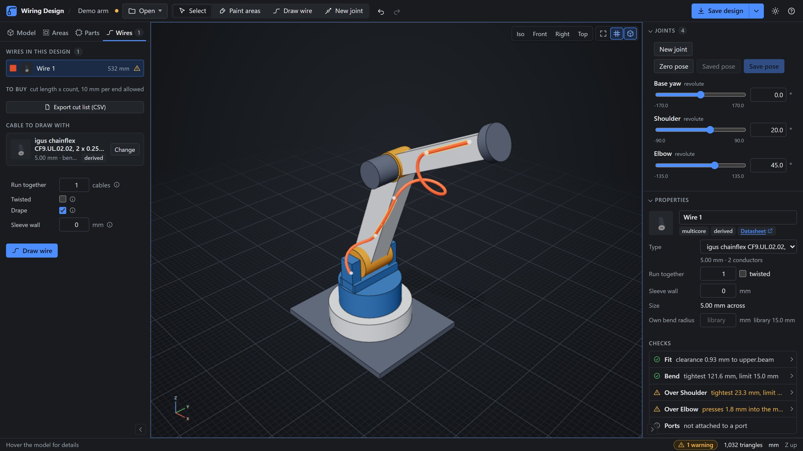

# Wiring Design

[](https://github.com/whk-irl/prototype-wiring-design/actions/workflows/ci.yml) [](LICENSE)

Plan the wiring of a robot or machine on its 3D model, with real cables at their real size, before you build it.



Wiring is usually the last thing designed and the first thing to fail: a cable that is too short at one end of a joint's travel, a bend tighter than the cable allows, a plug with no room to seat. Wiring Design lets you find those on the model. You load the CAD, place the boards and sensors, draw each wire from port to port with a cable from a library of real types, and the app shows the shape the wire takes and checks it across the range of motion.

It runs entirely in your browser, on your own computer. Nothing is uploaded.



## What works today

- **Models.** Open STEP, IGES, glTF, STL, OBJ or a URDF with its meshes. A CAD model with no joints can be given them: select the bodies that move and click a pin, shaft or hole to set each axis.
- **Parts.** 64 real boards, sensors, drivers and motors (Arduino, Raspberry Pi, ESP32, STM32, Teensy, Adafruit), 45 with 3D models from files their makers published, each with its ports: position, direction and connector. Five generic stand-ins (a controller, a single-board computer, a breakout, a motor driver, a camera) cover what is not in the list yet. Add your own from a 3D model or a KiCad board file.
- **Cables.** 39 real types (hook-up wire, silicone wire, ribbon, flat flex, coax, USB, Ethernet, ready-made leads), each with its size, bend radius and where every figure came from. Add your own from a few figures, including flexible printed circuits; the app says which figures it worked out and by what rule.
- **Wires that behave like wires.** A wire is drawn as a stiff rod held where you clicked: it rounds corners, rests on what it touches, and hangs in a loop where it crosses a joint. See [how the shape is worked out](docs/WIRE_SHAPE.md).
- **Checks.** Fit against the model, parts and other wires at true size; tightest bend against the cable's limit; whether the loop over a joint reaches, how tightly it bends and where it goes across the joint's range; whether the cable goes into the connector at each end; cut length, with a cut list you can export.
- **Compare.** One table of cable types judged on the same route.

## What does not exist yet

No automatic routing, no rule engine, no STEP or GLB export of the finished harness. The shape of a wire leaves out twist and friction, and its sag is an estimate (the document above says exactly what is assumed). Checks are a design aid: measure the real prototype before you trust a tight clearance.

## Run it

Node.js 22.13 or newer in the 22 line, 24, or 26 and later. A current desktop browser with WebGL 2 and WebAssembly (Chrome, Edge or Firefox; it was checked in a Chromium browser).

```
git clone https://github.com/whk-irl/prototype-wiring-design.git
cd prototype-wiring-design
npm install
npm run dev
```

Then open http://localhost:5173 and choose **Load the demo arm**, or drop your own model on the view. The server listens on your own computer only; models and designs never leave it.

Other commands: `npm test`, `npm run typecheck`, `npm run lint`, `npm run build`, and `npm run schema` (regenerates `schema/design.schema.json`; a test fails if the committed file is out of date).

## How it is put together

| Path | Contents |
|---|---|
| `src/core/` | Pure TypeScript, no browser or Node dependencies: the design-file schema, validation, kinematics, cable and connector rules, and the solvers for the shape of a wire |
| `src/app/` | The browser app: React, three.js, zustand |
| `library/` | Parts, connectors and cables (YAML), every figure with its source |
| `rules/` | Wiring rules (YAML); the format is defined, the rule engine is not built yet |
| `public/parts/` | 3D models of the library parts and their licence notice |
| `schema/` | Generated JSON Schema of the design file |
| `tests/` | Unit and property tests |
| `tools/` | Development scripts: the part-model builder, fixture generators, the schema emitter |
| `docs/` | The plan, the rules and where they come from |

A design is one `design.json` file next to your model files. Its format is the schema in `schema/design.schema.json`.

## Documents

- [docs/WIRE_SHAPE.md](docs/WIRE_SHAPE.md): how the shape of a wire is worked out, and what the model leaves out
- [docs/CABLES.md](docs/CABLES.md): the cable library, the bend-radius rules and their sources
- [docs/CONNECTORS.md](docs/CONNECTORS.md): the connector library
- [docs/PLAN.md](docs/PLAN.md): goals, architecture, milestones and where the project stands
- [docs/TEST_PLAN.md](docs/TEST_PLAN.md): how the project is tested
- [docs/DEVELOPMENT_LOG.md](docs/DEVELOPMENT_LOG.md): how the project was built with AI assistance, and what each review found

## Contributing

See [CONTRIBUTING.md](CONTRIBUTING.md). Library entries are welcome, as long as every figure says where it came from. Found a problem? Open an issue with what you did and what happened; a `design.json` that shows it helps most.

## Licence

Apache License 2.0, see [LICENSE](LICENSE) and [NOTICE](NOTICE). The 3D models of parts carry their makers' licences, listed in [public/parts/NOTICE.md](public/parts/NOTICE.md). The software the built app contains, including the LGPL-2.1 library that reads STEP files, is listed in [public/THIRD_PARTY_NOTICES.md](public/THIRD_PARTY_NOTICES.md).
